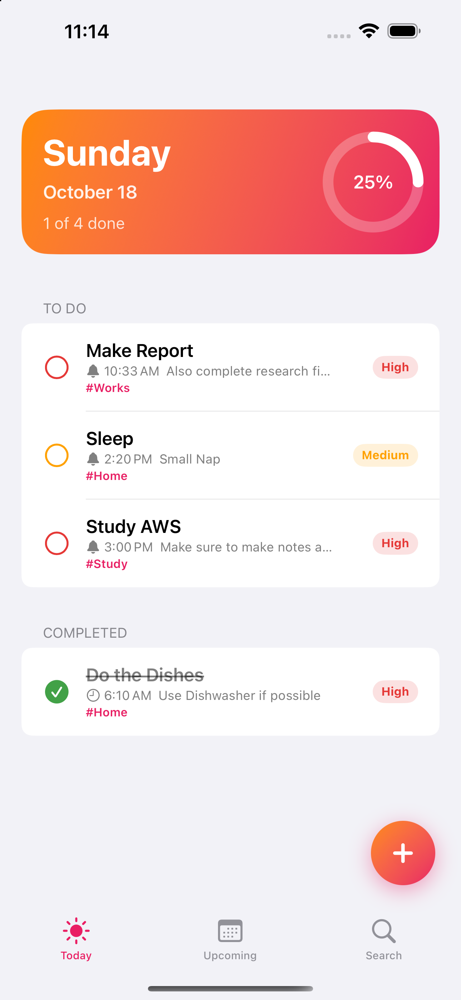
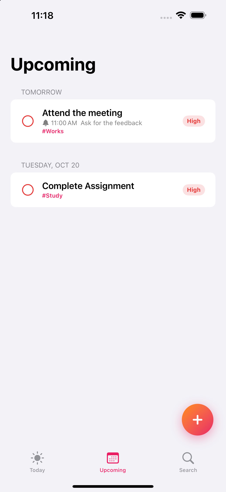
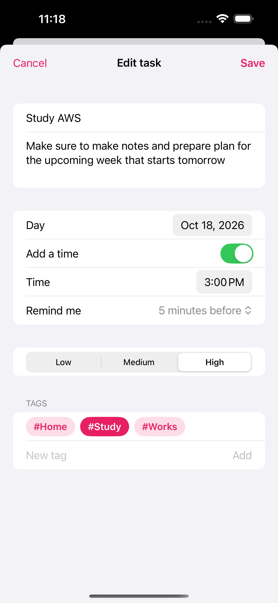
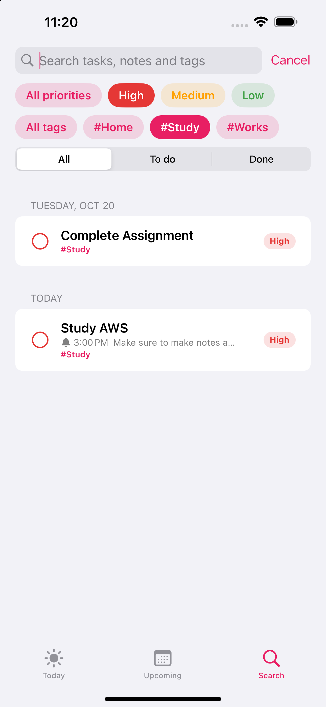

# Taskful

A daily planner for iOS 17+, built with SwiftUI and SwiftData as a hands-on way to learn native iOS development.

<p float="left">
  
  
  
  
</p>

## Features

- **Today** screen with a gradient header, a progress ring, and tasks sorted by time, then priority
- **Upcoming** screen with tasks grouped by day and an Overdue section
- **Search** tab to find tasks by text, and filter by priority, tag, and done or not done
- Add, edit, complete and delete tasks, saved on the device
- Optional time of day, with reminder notifications
- Tags you can put on any task
- Sunset color palette and a custom app icon

## Built with

- SwiftUI for the interface
- SwiftData for saving tasks and tags
- UserNotifications for local reminders
- Swift Testing for unit tests

## Requirements

- Xcode 16 or newer
- iOS 17 or newer (simulator or device)

## Run it

1. Open `TodoList.xcodeproj` in Xcode.
2. Pick an iPhone simulator.
3. Press Run (⌘R). Press ⌘U to run the tests.

## Project layout

```
TodoList/
  App/        App entry point and database setup
  Models/     PlannerTask, TaskTag, Priority, DayGroup, TaskFilter
  Services/   Reminder notifications
  Theme/      Colors
  Views/      Today, Upcoming, Search, task form and small reusable views
  Resources/  Asset catalog (app icon and accent color)
TodoListTests/  Unit tests
```
